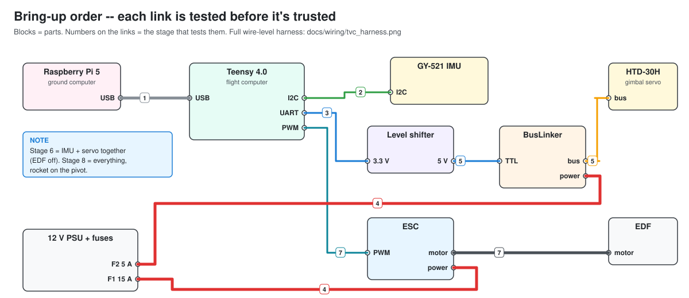
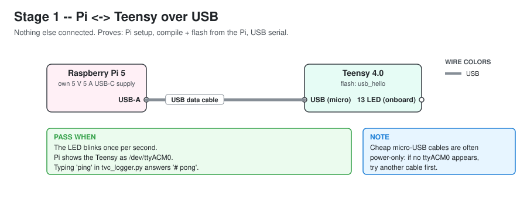
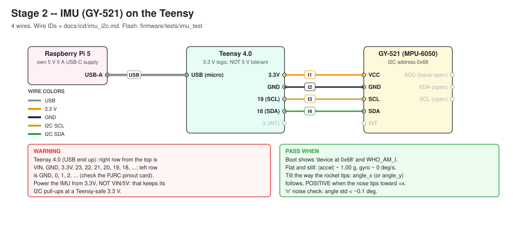
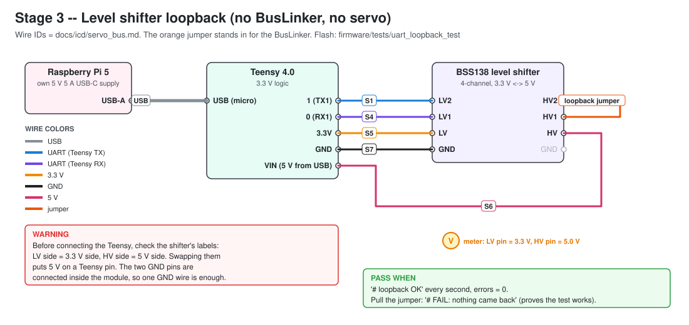
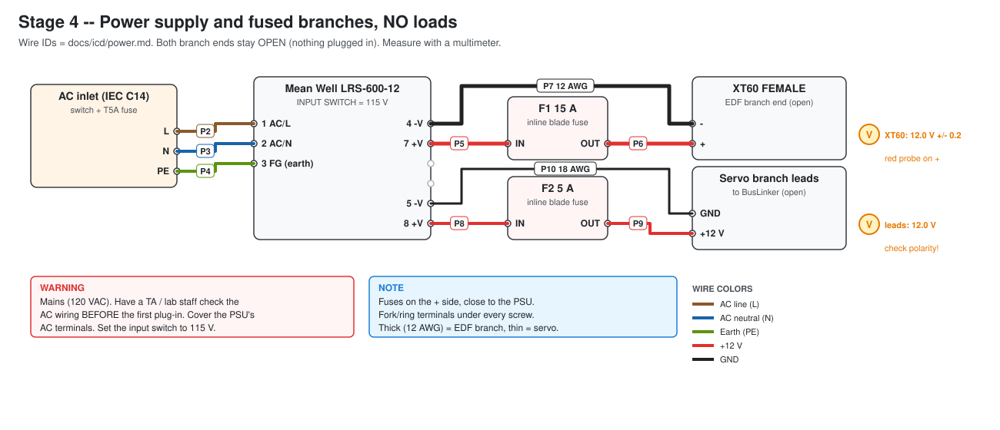
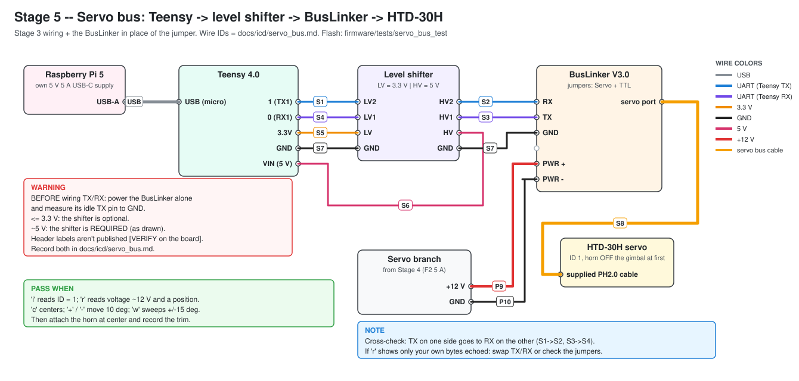
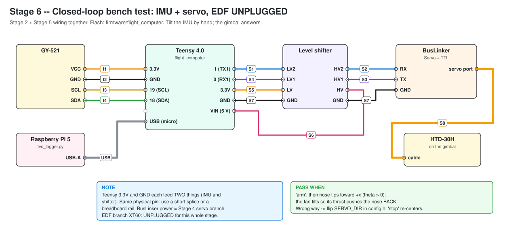
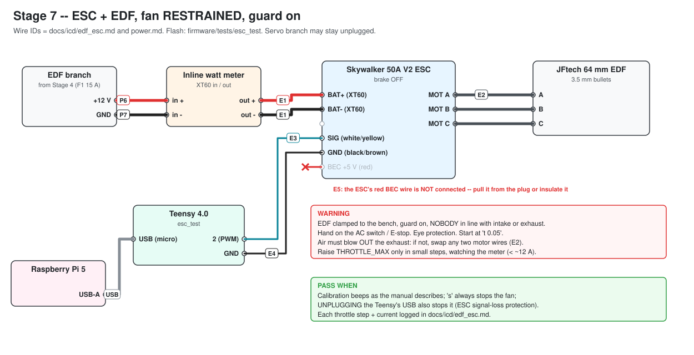

# Bring-up procedure: test each piece before putting it all together

Work through the stages **in order**. Each stage adds one new piece to hardware that has already passed, so when something fails, the cause is the piece you just added. Don't skip ahead. A stage that "probably works" is the one that will cost you an afternoon later.



| Stage | Adds | Sketch to flash | Mains power? | Fan spins? |
|---|---|---|---|---|
| [0](#stage-0--set-up-the-raspberry-pi) | Raspberry Pi setup | — | no | no |
| [1](#stage-1--pi--teensy-over-usb) | Teensy on USB | `firmware/tests/usb_hello` | no | no |
| [2](#stage-2--imu) | IMU (GY-521) | `firmware/tests/imu_test` | no | no |
| [3](#stage-3--level-shifter-loopback) | Level shifter | `firmware/tests/uart_loopback_test` | no | no |
| [4](#stage-4--power-supply-no-loads) | 12 V PSU, fuses, branch wiring | — (multimeter) | **yes** | no |
| [5](#stage-5--servo-bus) | BusLinker + HTD-30H servo | `firmware/tests/servo_bus_test` | yes | no |
| [6](#stage-6--closed-loop-bench-test-edf-unplugged) | IMU + servo closed loop | `firmware/flight_computer` | yes | no |
| [7](#stage-7--esc--edf-fan-restrained) | ESC + EDF | `firmware/tests/esc_test` | yes | **yes, restrained** |
| [8](#stage-8--full-system-on-the-pivot) | Everything, rocket on the pivot | `firmware/flight_computer` | yes | **yes** |

Stages 1–3 need only the Pi, the Teensy, a USB cable, and jumper wires, so you can do them before the power hardware arrives.

## Rules for every stage

1. **Power off while you change wiring.** Unplug the Teensy's USB and switch off the PSU before moving any wire.
2. **Check the wiring against the stage diagram before powering up.** Have a second person check stages 4, 7 and 8.
3. **One change at a time.** If a stage fails, go back to the last setup that passed, not forward.
4. **Write down what you measure.** Each stage has a *Record* section. Copy the values into the matching ICD in `docs/icd/` and replace the `[VERIFY]` tags.
5. **Anything with the fan:** restrained, guarded, nobody in line with the intake or exhaust, eye protection, hand on the AC switch / E-stop.

Wire IDs in the diagrams (`I1`, `S5`, `P7`, ...) match the connection tables in `docs/icd/*.md` and the full harness in `docs/wiring/tvc_harness.png`. Diagrams are generated by `make_diagrams.py` in this folder.

---

## Stage 0 — Set up the Raspberry Pi

**Goal:** the Pi can compile Arduino sketches, flash the Teensy, and talk to it.

**You need:** Raspberry Pi 5 with Raspberry Pi OS **64-bit**, its 5 V 5 A USB-C supply, internet, keyboard/screen or SSH.

1. Get the repo onto the Pi:
   ```bash
   git clone https://github.com/nsappling/ThrustVectorControl.git
   ```
   ```bash
   cd ThrustVectorControl
   ```
2. Run the one-time setup (5–10 minutes; it downloads the Teensy toolchain):
   ```bash
   bash ground/setup_pi.sh
   ```
3. **Log out and back in** (or reboot) so the serial-port permission applies.

**Pass when:** the script's last lines show paths for `arduino-cli` and `teensy_loader_cli`, and a `teensy:avr` core.

**Later:** to get new code onto the Pi, run `git pull` in the `ThrustVectorControl` folder.

---

## Stage 1 — Pi ↔ Teensy over USB

**Goal:** prove the whole chain: compile on the Pi → flash the Teensy → USB serial both ways.



1. Plug the Teensy into the Pi with the micro-USB cable. Nothing else connected.
2. Flash the test sketch:
   ```bash
   bash ground/flash.sh firmware/tests/usb_hello
   ```
   The **first** flash of a new Teensy: press the white button on the Teensy when it says *Waiting for Teensy device*.
3. Open the console and type `ping`:
   ```bash
   python3 ground/tvc_logger.py
   ```

**Pass when:** the orange LED blinks once per second, the console prints `# alive, uptime N s` every second, and `ping` answers `# pong`. Quit with Ctrl+C.

**If it fails:**
| Symptom | Likely cause |
|---|---|
| `No board found` / no `/dev/ttyACM0` | Power-only USB cable (very common), or you didn't log out/in after setup |
| `Permission denied` on the port | Not in the `dialout` group yet: log out and back in |
| Flash waits forever | Press the Teensy's white button; check the udev rules step in `setup_pi.sh` |

---

## Stage 2 — IMU

**Goal:** the GY-521 answers on I2C, reads gravity correctly, and its angle sign matches the sim's convention.



1. Unplug USB. Wire the 4 IMU wires (I1–I4). The IMU gets **3.3 V, not 5 V**.
2. Plug in USB and flash:
   ```bash
   bash ground/flash.sh firmware/tests/imu_test
   ```
3. Open the console (`python3 ground/tvc_logger.py`). If you missed the boot messages, type `scan`.
4. Lay the IMU flat and still. Type `n` for a 2-second noise check.
5. Hold the IMU the way it will sit on the rocket (Z axis along the body). Tip the "nose" toward **+x**, the side you've defined as positive. Watch `angle_x_deg` and `angle_y_deg`.

**Pass when:**
- Boot shows `device at 0x68`. `WHO_AM_I = 0x68` is genuine; 0x70/0x72/0x98 is a clone, which is OK if the readings below look right.
- Flat and still: `az_g` ≈ 1.00, `ax_g` and `ay_g` ≈ 0, and the noise check shows `|accel|` mean ≈ 1.00 g and gyro std dev < ~0.1 deg/s.
- Tipping the nose toward +x makes one angle go **positive** and track the tilt. That angle is your axis.

**Record:** which angle tracked the tilt (`angle_x` → `IMU_USE_Y_AXIS = false`, `angle_y` → `true`), its sign (positive → `IMU_SIGN = 1.0`, negative → `-1.0`), and the gyro means (bias). Put them in `firmware/flight_computer/config.h` and tick the boxes in `docs/icd/imu_i2c.md`.

**If it fails:**
| Symptom | Likely cause |
|---|---|
| `NOTHING found` | SDA/SCL swapped (18 = SDA, 19 = SCL), no 3.3 V, or a loose ground |
| Found, but `read FAILED` messages | Loose jumper; long or untwisted wires |
| Angle jumps around by degrees at rest | Board loose or vibrating; check the noise numbers |

---

## Stage 3 — Level shifter loopback

**Goal:** prove the Teensy's servo serial port and the 3.3 V ↔ 5 V level shifter work, **before** the BusLinker or servo is involved.



1. Unplug USB. You can leave the IMU connected.
2. Wire the shifter (S1, S4, S5, S6, S7). **Check the labels: LV = Teensy (3.3 V) side, HV = 5 V side.** Swapping them puts 5 V on a Teensy pin, and the Teensy 4.0 is not 5 V tolerant.
3. Add the loopback jumper from **HV2 to HV1**.
4. Plug in USB. With a multimeter, measure **LV pin to GND ≈ 3.3 V** and **HV pin to GND ≈ 5.0 V**.
5. Flash and watch:
   ```bash
   bash ground/flash.sh firmware/tests/uart_loopback_test
   ```
   ```bash
   python3 ground/tvc_logger.py
   ```
6. Pull the jumper off for a few seconds, then put it back.

**Pass when:** `# loopback OK` every second with `errors 0` while the jumper is on, and `# FAIL: nothing came back` while it's off (this proves the test can fail).

**If it fails:** nothing comes back → LV1/LV2 swapped, LV or HV unpowered, or a missing ground. Bytes wrong → bad ground or a loose wire.

---

## Stage 4 — Power supply, no loads

**Goal:** the PSU makes 12 V, the fuses are in, and both branches have the right polarity, with **nothing plugged in**.



> ⚠️ **This stage involves 120 VAC mains.** Have a TA or lab staff member check the AC wiring (P2–P4) **before the first plug-in**. Cover the PSU's AC terminals. Set the PSU's input switch to **115 V** first. Everything here is also in `docs/icd/power.md`.

1. With the inlet **unplugged**: check continuity from the PSU's FG terminal to the wall plug's earth pin.
2. Install F1 (15 A) and F2 (5 A). Leave the XT60 and the servo-branch leads **unconnected**.
3. Plug in and switch on. The PSU's LED lights.
4. Measure at the PSU's +V/−V terminals, at the XT60 female (red probe on **+**), and at the servo-branch leads.
5. Switch off and unplug.

**Pass when:** 12.0 V ± 0.2 V everywhere, with the **correct polarity** at both branch ends. Pull-test every crimp.

**Record:** the voltages, in the `docs/icd/power.md` checklist.

---

## Stage 5 — Servo bus

**Goal:** the Teensy can command the HTD-30H through the shifter and BusLinker, and read back its ID, voltage and position.



1. **Measure the BusLinker's logic level first.** Set its jumpers to **Servo + TTL**. Connect only its power (P9, P10, from the servo branch), switch on, and measure the BusLinker's **TX header pin to GND**. Switch off.
   - ≤ 3.3 V: the shifter is optional (keep it anyway; it doesn't hurt).
   - ≈ 5 V: the shifter is **required**, as drawn.

   Record the header's pin labels and this voltage in `docs/icd/servo_bus.md`.
2. Replace the Stage 3 loopback jumper with the BusLinker: shifter HV2 → BusLinker **RX** (S2), BusLinker **TX** → HV1 (S3), and ground (S7).
3. Plug the servo into the BusLinker with its supplied cable (S8). **Keep the servo horn off the gimbal** for now, so a wrong move can't hit a hard stop.
4. Switch on the PSU, plug in the Teensy, and flash:
   ```bash
   bash ground/flash.sh firmware/tests/servo_bus_test
   ```
   ```bash
   python3 ground/tvc_logger.py
   ```
5. Type each command and press Enter: `i` (read ID), `r` (read position, voltage, temperature), `c` (center), `+` and `-` (±10°), `w` (slow ±15° sweep), `l` (limp), `t` (torque on).
6. Send `c` to center the servo. Fit the horn so the gimbal is **straight**, then attach the gimbal linkage.

**Pass when:** `i` shows `servo ID = 1`, `r` shows a voltage of ≈ 12 V and a position near 500 after `c`, and the servo moves for `+`, `-` and `w`.

**Record:** the BusLinker pin labels, its idle TX voltage, the servo voltage, and which way `+` turns the gimbal (needed for `SERVO_DIR` in stage 6).

**If it fails:** `raw:` shows only your own bytes → TX/RX crossed wrong (S2/S3), or the jumpers aren't on Servo + TTL. Nothing at all → the BusLinker isn't powered, or a shifter wire is loose. Voltage reads ~5 V → the BusLinker is powered from USB or the wrong supply.

---

## Stage 6 — Closed-loop bench test (EDF unplugged)

**Goal:** `flight_computer` runs the real control loop: tilt the IMU by hand and the gimbal responds in the right direction. **The EDF branch XT60 stays unplugged.**



1. Wiring = Stage 2 + Stage 5 together. The Teensy's 3.3V and GND pins each feed two things; use a short splice or breadboard rail.
2. Put your stage 2 IMU settings (`IMU_USE_Y_AXIS`, `IMU_SIGN`) into `firmware/flight_computer/config.h`.
3. Hold the IMU (or the rocket) **upright and still**, then flash:
   ```bash
   bash ground/flash.sh firmware/flight_computer
   ```
   ```bash
   python3 ground/tvc_logger.py
   ```
   The console shows `[flight_computer detected: sending heartbeat ...]`. It starts in **SAFE** (slow LED blink).
4. Type `status`, then `arm` (ARMED, fast blink). Gimbal control is live; the EDF can't run in this state.
5. **Direction check (critical):** tip the nose toward +x (θ > 0, check `theta_deg` is positive). The fan must tilt so its **thrust pushes the nose back** toward upright. If it tilts the wrong way, send `stop`, flip `SERVO_DIR` in `config.h`, re-flash, and repeat.
6. Tip past 25° (`THETA_TRIP_DEG`): it should go to **FAULT** and center. Send `stop` to clear it.
7. Quit the console with Ctrl+C. It sends `stop` automatically.

**Pass when:** the direction is right, the gimbal follows smoothly with no buzzing or chatter, FAULT trips past 25°, and `stop` always centers.

**Record:** `SERVO_DIR`, the servo trim (`trim <counts>` until the gimbal is straight at θ = 0), and a log file (`ground/logs/`) of a few tilts to compare against the sim.

---

## Stage 7 — ESC + EDF (fan restrained)

**Goal:** calibrate the ESC's throttle range, confirm spin direction, and find a safe throttle cap, with the **fan clamped to the bench**.



> ⚠️ EDF clamped down, guard on, **nobody in line with the intake or exhaust**, eye protection, hand on the AC switch. Inline watt meter in the XT60 line. Full procedure: `docs/icd/edf_esc.md`.

1. Wire the ESC signal lead to the Teensy: signal → pin 2 (E3), signal ground → GND (E4). **The ESC's red BEC wire must not connect to anything (E5).** Pull it out of the plug or insulate it.
2. Flash:
   ```bash
   bash ground/flash.sh firmware/tests/esc_test
   ```
   ```bash
   python3 ground/tvc_logger.py
   ```
3. **Throttle calibration:** type `cal` and follow the prompts. Plug the XT60 in only when it tells you to.
4. **Spin direction:** `t 0.05`. Air must blow **out of the exhaust**. If not: `s`, switch off, swap any two motor wires (E2), and retry.
5. **Stop checks:** while it's spinning at `t 0.05`, check that `s` stops it, and that **unplugging the Teensy's USB** stops it (the ESC's signal-loss protection).
6. **Throttle steps:** `t 0.10`, `t 0.15`, ... up to the test cap (0.30), watching the watt meter. Stop below ~12 A steady.

**Pass when:** calibration beeps match the manual, the air flows the right way, both stop methods work, and you've logged current vs. throttle.

**Record:** the current vs. throttle table in `docs/icd/edf_esc.md`. Set `THROTTLE_MAX` in `config.h` to the highest step that stayed under ~12 A.

---

## Stage 8 — Full system on the pivot

**Goal:** first closed-loop run with thrust.

1. Everything from stages 6 and 7 connected, matching the full harness (`docs/wiring/tvc_harness.png`). Rocket on the pivot, with the mechanical stops installed.
2. **Turn on the heartbeat timeout:** set `HOST_TIMEOUT_MS = 1000` in `config.h`. That way, if the Pi or the console dies, the Teensy drops to SAFE within 1 s. `tvc_logger.py` sends the heartbeat automatically.
3. Flash `flight_computer`. Hold the rocket upright and still while it calibrates.
4. In the console, step through the states one at a time, with a hand on the E-stop:
   - `arm`, then check the gimbal still responds correctly to a hand tilt.
   - `throttle 0.05`, then `run` for 2–3 s, then `stop`.
   - Raise the throttle in small steps toward the level where thrust can hold the rocket upright, a few seconds per run.
5. **Heartbeat check:** while in RUN at low throttle, kill the console with Ctrl+C. It sends `stop`. Then repeat the test by closing the terminal window instead: the Teensy should drop to SAFE within ~1 s on its own.

**Pass when:** it holds upright against small nudges, `stop` and the heartbeat timeout both shut the fan off, and the logs look like the sim (`sim/pid_animation/analyze_behavior.m`, `sim/tvc_sim/tvc_main.m`).

**After the first runs:** compare the logged θ and gimbal angle against the simulation, update the `[EST]` parameters (mass, CG height, inertia, thrust), and re-tune.

---

## Files used in this procedure

| Where | What |
|---|---|
| `ground/setup_pi.sh` | One-time Pi setup |
| `ground/flash.sh` | Compile + upload any sketch folder to the Teensy |
| `ground/tvc_logger.py` | Console + CSV logger (`ground/logs/`), heartbeat, sends `stop` on exit |
| `firmware/tests/usb_hello` | Stage 1 |
| `firmware/tests/imu_test` | Stage 2 |
| `firmware/tests/uart_loopback_test` | Stage 3 |
| `firmware/tests/servo_bus_test` | Stage 5 |
| `firmware/tests/esc_test` | Stage 7 |
| `firmware/flight_computer` | Stages 6 and 8 |
| `docs/bringup/make_diagrams.py` | Regenerates the stage diagrams in `img/` |
