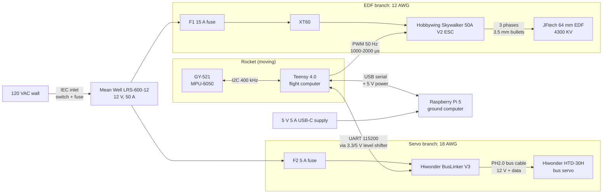

# System Overview

**Status:** Preliminary (rev A, Oct 2026). Nothing has been built or measured yet. Values marked **[VERIFY]** come from seller listings or comparable parts and must be checked on the bench.

## Block diagram

Whether the Teensy and IMU ride on the rocket or sit on the base depends on the mechanical design. The wiring is the same either way. Anything that crosses the pivot needs a flexible, strain-relieved cable.

## Responsibilities

| Unit | Job | Runs without the others? |
|---|---|---|
| Teensy 4.0 | 400 Hz control loop: read IMU → estimate angle → PID → command servo. Sets EDF throttle. Owns all safety trips. | Yes. It only needs USB power. |
| Raspberry Pi 5 | Logging, tuning, and later the joystick and exhibit UI. Sends setpoints and commands; never sits inside the fast loop. | — |
| BusLinker | Converts the Teensy's 2-wire UART to the servo's 1-wire half-duplex bus and passes 12 V to the servo. | — |
| ESC | Turns the 12 V DC supply into 3-phase motor drive for the EDF, set by the throttle pulse width. | — |

## Power budget

| Load | Nominal | Worst case | Branch limit |
|---|---|---|---|
| EDF + ESC | Set by throttle | **~50 A at full throttle [VERIFY]** | **15 A fuse (≈180 W)**, so firmware must cap the throttle |
| HTD-30H servo | < 1 A moving | 3 A stall | 5 A fuse |
| BusLinker logic | < 0.1 A | — | (servo branch) |
| Teensy + IMU | ~0.1 A at 5 V | — | Pi USB port |
| Pi 5 | 1–3 A at 5 V | 5 A | Its own wall supply |
| **PSU total** | | **≤ 20 A** (fuse-limited) | PSU rating 50 A |

The PSU only shuts down at 105–150 % of its rating (52–75 A). That is far above what the wiring is sized for, so **the fuses protect the wiring, not the PSU**.

## Ground scheme

All grounds are tied together: PSU −V, ESC, BusLinker, Teensy, and IMU. The Pi joins them through the USB cable. High current returns only on the 12 AWG / 18 AWG power negatives. The thin signal grounds carry reference current only. If a 12 AWG negative comes loose, EDF current can try to return through a signal ground and the USB cable, so crimp and inspect the power negatives as carefully as the positives.

## Key design decisions (and why)

1. **The servo runs straight off 12 V.** The HTD-30H is rated 9–12.6 V, so no buck converter is needed. Keep the PSU at its factory 12.0 V; don't turn the adjustment pot up past 12.6 V.
2. **The HTD-30H is a serial bus servo, not a PWM servo.** It takes position commands as packets (0–1000 = 0–240°) and can report its actual position, voltage, and temperature. So we can log the real gimbal angle, not just the commanded one. The old `firmware/tvc_controller` (PWM, Uno) **won't drive it**; use `firmware/flight_computer`.
3. **The Teensy 4.0 is 3.3 V only, and its pins are not 5 V tolerant.** The servo bus idles at 5 V, so the Teensy ↔ BusLinker UART goes through a level shifter. The IMU is powered from the Teensy's 3.3 V pin so its I2C pull-ups stay at 3.3 V.
4. **The Teensy is powered from Pi USB.** The ESC's built-in 5 V BEC is **not used**. Its red wire is left disconnected, because the Teensy's VIN and USB 5 V are joined.
5. **The EDF is throttle-capped in firmware** (`THROTTLE_MAX` in `config.h`) to stay under the 15 A fuse. Raise the cap only while watching an inline watt meter.

## Open items / decisions needed

| # | Item | Owner | Notes |
|---|---|---|---|
| 1 | Is ~180 W (15 A) enough EDF thrust? | | Estimate ≈ 5–7 N at 15 A [VERIFY]. The sim assumes `T_max = 6.5 N`. Measure on the thrust stand, then update `tvc_params.m`. |
| 2 | ESC is 50 A continuous, but the EDF seller recommends 80 A | | OK while fuse-limited. Revisit if the fuse is ever raised. |
| 3 | BusLinker serial header pin labels and logic level | | Read the silkscreen and measure the idle TX voltage on receipt (see [ICD servo bus](icd/servo_bus.md)). |
| 4 | E-stop | | Recommended: a latching mains-rated E-stop on the AC input, plus firmware disarm. Required before any public demo. |
| 5 | AC inlet fuse size | | Proposed: T5A slow-blow (our draw is ≤ 250 W ≈ 2.5 A AC). |
| 6 | Servo latency and update rate | | Step-test it. The sim's `servo_refresh` / `servo_tau` need real numbers. |
| 7 | Joystick | | Planned: USB gamepad on the Pi, which sends setpoints over the USB link. |
| 8 | Carrier board for the Teensy (level shifter, connectors) | | Perfboard first, then maybe a KiCad PCB. |

## Documents

- [components.md](components.md): specs and sources for every part
- [pinout.md](pinout.md): Teensy pin assignments (the single source of truth)
- `icd/`: one interface control document per interface
- [wiring/](wiring/): harness diagram (generated from `tvc_harness.yml`)
